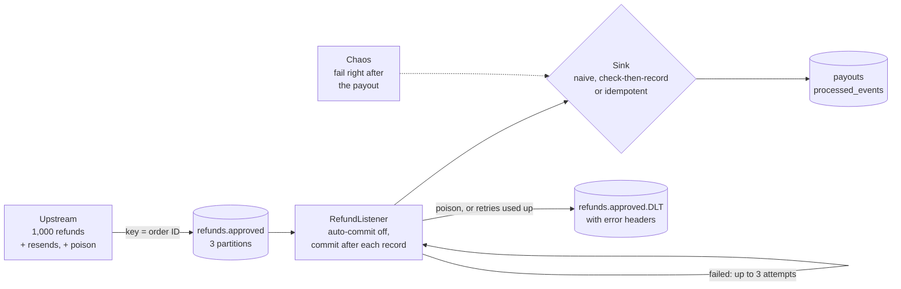

# kafka-idempotent-consumer

[](https://github.com/MoAlrubaie/kafka-idempotent-consumer/actions/workflows/ci.yml)


[](LICENSE)

A Spring Boot Kafka consumer that pays out refunds, run three ways against the same stream of
events, with duplicate delivery switched on deliberately: upstream resends, crashes at the worst moment, and
a full replay of the topic. Only one of the three pays every refund exactly once.

Kafka delivers at least once, so a consumer that has side effects will see the same event
twice sooner or later. Kafka's exactly-once features cover writes from Kafka to Kafka. They
don't cover your database, your payment provider or your email server. This repo shows what
does: an operation that is safe to repeat. It runs with **no Docker**, in about 15 seconds
once the first build has downloaded its dependencies.

## Quick start

You need Java 21 or newer and `make`. Maven comes with the repo (`./mvnw`).

```bash
git clone https://github.com/MoAlrubaie/kafka-idempotent-consumer.git
cd kafka-idempotent-consumer
make demo
```

`make demo` starts a Kafka broker inside the JVM, publishes 1,000 refunds with some trouble
mixed in, then runs the real service once per sink, each against its own empty database:

```text
Stream: 1,000 refunds worth $132,080.48 on refunds.approved, keyed by order ID (3 partitions)
  + 32 resends   the upstream retried and published the same event again
  + 4 poison     bad JSON or a negative amount, can never succeed
  chaos: 5% of events crash once right after the payout, before the bookkeeping

Round 1: deliver the stream once
  sink               deliveries  crashes  skipped    DLT  payouts      paid out      overpaid
  naive                   1,084       48        0      4    1,080   $143,812.06   +$11,731.58
  check-then-record       1,084       48       32      4    1,048   $139,774.14    +$7,693.66
  idempotent              1,084       48       32      4    1,000   $132,080.48             -

Round 2: rewind the consumer group to the start and replay the whole topic
  sink               deliveries  crashes  skipped    DLT  payouts      paid out      overpaid
  naive                   1,036        0        0      4    2,112   $279,930.46  +$147,849.98
  check-then-record       1,036        0    1,032      4    1,048   $139,774.14    +$7,693.66
  idempotent              1,036        0    1,032      4    1,000   $132,080.48             -

  naive              paid 78 refunds more than once in round 1, paid 1,032 more on the replay ($147,849.98 too much)
  check-then-record  paid 48 refunds more than once in round 1, replay changed nothing ($7,693.66 too much)
  idempotent         every refund paid exactly once, through 2,120 deliveries
```

The numbers are the same every run. Everything random is seeded (`DEMO_ARGS="--seed 11"`
gives a different, equally repeatable run), and the demo exits non-zero if the idempotent sink
ever pays a refund twice or misses one.

How to read the columns:

| Column | Meaning |
| --- | --- |
| deliveries | Records handed to the listener, counting retries and redeliveries |
| crashes | Times the chaos switch failed a record right after its payout |
| skipped | Deliveries the sink recognised as already paid |
| DLT | Records parked on the dead-letter topic |
| payouts | Payment rows in the database (a total, so round 2 includes round 1) |
| overpaid | Money paid beyond the 1,000 refunds that were actually approved |

## How it works



The service is an ordinary Spring Boot app: a `@KafkaListener` that parses each record and
hands it to a `RefundSink`. Making the payment means inserting a row into `payouts`. That
table deliberately has no unique constraint on the event ID: like a card refund or an email,
doing it twice simply happens twice. Protecting against that is the sink's job.

The demo publishes one stream, then for each sink starts the service with its own consumer
group and an empty database, waits until the group has committed every offset (round 1),
rewinds the group to offset 0 the way `rpk group seek --to start` would, and waits again
(round 2).

## The three sinks

**[`NaiveSink`](src/main/java/io/github/moalrubaie/refunds/sink/NaiveSink.java)** pays every
delivery. Its only bookkeeping is the offset commit, which happens after the payment. Every
resend, every crash before the commit and every replay is another payment.

**[`CheckThenRecordSink`](src/main/java/io/github/moalrubaie/refunds/sink/CheckThenRecordSink.java)**
is the usual first fix: look the event ID up in `processed_events`, pay, then record the ID.
It stops resends and replays completely. But the payment and the record are two separate
writes, and a crash between them leaves a payment that nobody wrote down. The redelivered
event passes the check and pays again: 48 crashes, 48 refunds paid twice.

**[`IdempotentSink`](src/main/java/io/github/moalrubaie/refunds/sink/IdempotentSink.java)**
records the event ID and makes the payment in **one transaction**, and lets the primary key
decide:

```java
transaction.executeWithoutResult(tx -> { // all or nothing
    int inserted = jdbc.sql("INSERT INTO processed_events (event_id) VALUES (?) ON CONFLICT DO NOTHING")
            .param(event.eventId())
            .update();
    if (inserted == 0) {
        stats.duplicateSkipped(); // seen before: do nothing
        return;
    }
    payouts.pay(event);
    chaos.afterEffect(event.eventId()); // a crash here rolls back the payment and the record
});
```

- A duplicate's insert finds the row already there, changes nothing, and the sink returns.
- A crash anywhere inside rolls back both rows, so the redelivery starts clean.
- Two copies racing on different consumers: one insert wins, and the other waits for it to
  commit, then finds the row. [`PostgresSinkTest`](src/test/java/io/github/moalrubaie/refunds/sink/PostgresSinkTest.java)
  fires four copies of each of 50 events at once against real Postgres and checks that 50
  payments come out.

## What it demonstrates

**1. Duplicates are normal, not an incident.** The demo produces them in three ordinary ways.
An upstream service retries after a lost acknowledgement and publishes the same event again.
A consumer fails after doing the work but before committing the offset, so Kafka redelivers.
Someone replays a topic to recover from a bug. None of these is a Kafka bug.

**2. Kafka's exactly-once doesn't reach your database.** The producer here has
`enable.idempotence=true` and `acks=all`, and it changes nothing for the sinks. It stops the
producer's own network retries from writing a message twice. An application that sends an
event a second time creates a second message, which Kafka is right to deliver. Kafka
transactions would make read-process-write atomic across topics, but a payment is not a
topic.

**3. A dedupe table needs to be in the same transaction as the effect.** That is the whole
difference between `check-then-record` and `idempotent`, and it is worth $7,693.66 in this run.

**4. Key on business identity.** The idempotency key is the event's own ID, carried by every
resend and replay. A key generated inside the consumer (a random UUID, a timestamp) would
differ between attempts and protect nothing.

**5. Commit after the work.** Auto-commit is off and the listener container commits each
record's offset only after the sink returns (`ack-mode: record`), so a crash redelivers
instead of losing a refund. See [`application.yml`](src/main/resources/application.yml).

**6. Retry, then park.** A failed record gets 3 attempts in total, then is published to
`refunds.approved.DLT` with the exception in its headers, and its offset is committed so the
partition moves on. Poison (bad JSON, a negative amount) is marked as not retryable and goes
straight to the DLT. See [`KafkaConfig`](src/main/java/io/github/moalrubaie/refunds/KafkaConfig.java).

**7. The cheapest test: deliver everything twice.** Round 2 is exactly that. If the totals
change on a replay, the consumer isn't idempotent.

## Running it on Redpanda and Postgres

The default run needs nothing but Java. To run the same demo against a real broker and a real
database, with Docker:

```bash
make up              # Redpanda, Redpanda Console and Postgres (docker-compose.yml)
make demo-redpanda   # the same demo, against them
```

Then look around:

- **Redpanda Console** at http://localhost:8080: open `refunds.approved.DLT` and read the
  `kafka_dlt-exception-*` headers on each parked record.
- **rpk** inside the container:

  ```bash
  docker compose exec redpanda rpk topic consume refunds.approved.DLT -n 2
  docker compose exec redpanda rpk group describe refund-payer-idempotent
  ```

- **Postgres** on port 15432 (user, password and database are all `refunds`). Each sink run
  truncates the tables, so they hold the last sink's results.

`make down` stops everything and deletes the data.

## Options

Pass options through `DEMO_ARGS`, for example `make demo DEMO_ARGS="--crash-rate 0.2 --sinks idempotent"`.

| Option | Default | Meaning |
| --- | --- | --- |
| `--events` | 1000 | Refunds to publish |
| `--resend-rate` | 0.03 | Share of events the upstream publishes twice |
| `--crash-rate` | 0.05 | Share of events that fail once, right after their payout |
| `--poison` | 4 | Records that can never be processed |
| `--seed` | 7 | Change it for a different, but repeatable, run |
| `--sinks` | all three | Comma-separated: `naive`, `check-then-record`, `idempotent` |
| `--bootstrap` | in-process broker | A Kafka or Redpanda address |
| `--jdbc-url`, `--jdbc-user`, `--jdbc-password` | in-memory H2 per sink | A Postgres database |

## Project layout

| Path | What it is |
| --- | --- |
| [`src/main/java/.../refunds/`](src/main/java/io/github/moalrubaie/refunds/) | The service: listener, Kafka error handling, chaos switch, counters |
| [`src/main/java/.../refunds/sink/`](src/main/java/io/github/moalrubaie/refunds/sink/) | The payment effect and the three sinks |
| [`src/main/resources/schema.sql`](src/main/resources/schema.sql) | `payouts` and `processed_events` (Postgres, or H2 in PostgreSQL mode) |
| [`src/test/java/.../refunds/demo/`](src/test/java/io/github/moalrubaie/refunds/demo/) | The demo: event generator, runner and report. It lives under `src/test` so the service doesn't depend on an embedded broker |
| [`docker-compose.yml`](docker-compose.yml) | Redpanda, Redpanda Console, Postgres |

## Tests

```bash
make test
```

- `SinkTest`: each sink against "every event twice" and "crash after the effect, then
  redeliver", on H2, without Kafka.
- `EndToEndTest`: the full service on an in-process Kafka broker. It checks the exact counts:
  for example, that check-then-record pays twice once per crash and never on a replay.
- `RedpandaPostgresTest` and `PostgresSinkTest`: the same run on Redpanda and Postgres
  containers, and the racing-copies test. They use Testcontainers, need Docker, and skip
  themselves without it. CI runs them.

CI also runs `make demo` on Java 21 and 25, and `make demo-redpanda` on the docker compose stack.

## What this is not

- **Not a payments system.** There is no money, provider or customer here, only rows in a table.
- **The effect lives in the same database as the dedupe record.** That is what lets one
  transaction cover both. For an effect in another system (a payment API, an email
  service), send the event ID as that system's idempotency key, if it supports one, and
  record what you attempted.
- **The crash is simulated.** The chaos switch throws an exception at the worst moment rather than
  killing the process. Kafka's response is the same as for a crash or a rebalance there: the
  uncommitted record is delivered again.
- **No cleanup of `processed_events`.** A real one needs a retention policy at least as long as
  your longest possible replay, or yesterday's events will pay out again.
- **No outbox.** If the service also published events after paying, it would need the outbox
  pattern to keep the database and the topic in step. That is out of scope here.
- **Slow handlers are not covered.** Poll intervals, pausing partitions and worker pools for
  long-running work are a separate topic.

## License

[MIT](LICENSE)
